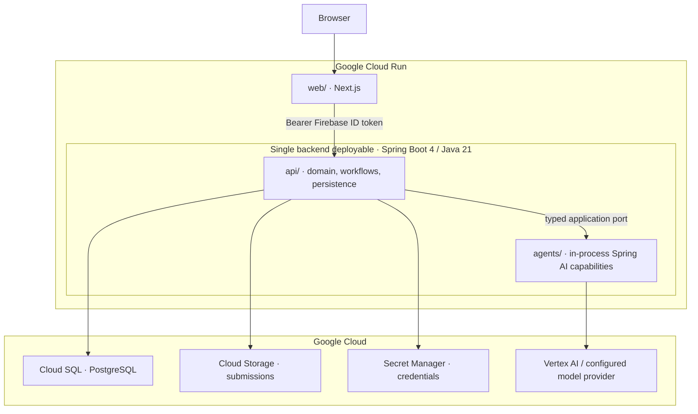

<a id="top"></a>

```
 ██████╗ ██████╗  █████╗ ██████╗ ███████╗ ██████╗ ██████╗ ███████╗    █████╗ ██╗
██╔════╝ ██╔══██╗██╔══██╗██╔══██╗██╔════╝██╔═══██╗██╔══██╗██╔════╝   ██╔══██╗██║
██║  ███╗██████╔╝███████║██║  ██║█████╗  ██║   ██║██████╔╝███████╗   ███████║██║
██║   ██║██╔══██╗██╔══██║██║  ██║██╔══╝  ██║   ██║██╔═══╝ ╚════██║   ██╔══██║██║
╚██████╔╝██║  ██║██║  ██║██████╔╝███████╗╚██████╔╝██║     ███████║██╗██║  ██║██║
 ╚═════╝ ╚═╝  ╚═╝╚═╝  ╚═╝╚═════╝ ╚══════╝ ╚═════╝ ╚═╝     ╚══════╝╚═╝╚═╝  ╚═╝╚═╝
```

<div align="center">

**AI-Native Assessment Operations Platform**

`grade-ops-ai` · Monorepo


</div>

---

## What this is

GradeOps AI helps programming educators operate assessment workflows with AI agents — from learning goal through grading, feedback, gap detection, and reports — while keeping teachers in control of every judgment, approval, and student-facing output.

Two assessment modes:

- **Open** — practical code/text submissions; rubric-based AI grading suggestions; teacher approval required before any result is acted on.
- **Closed** — objective questions (TF/SC/MC); AI-native question bank; deterministic grading against a frozen answer key.

---

## Repository structure

This is a **monorepo**. Each subdirectory is a self-contained component of the platform.

| Directory | Component | Stack | README |
|-----------|-----------|-------|--------|
| [`web/`](web/) | Teacher workspace (frontend) | Next.js 15 · TypeScript · Tailwind CSS · Firebase Auth | [web/README.md](web/README.md) |
| [`api/`](api/) | Domain API (backend) | Spring Boot 4 · Java 21 · PostgreSQL · Flyway | [api/README.md](api/README.md) |
| [`agents/`](agents/) | Internal AI capability module (not a separate service) | Spring AI · typed agent contracts · provider adapters | [agents/README.md](agents/README.md) |
| [`infra/`](infra/) | Cloud infrastructure | Terraform · Google Cloud Run · Cloud SQL · Secret Manager | [infra/README.md](infra/README.md) |
| [`docs/`](docs/) | Product and architecture documentation | Markdown | [docs/README.md](docs/README.md) |
| [`design-system/`](design-system/) | UI/UX governance and design workflow | Markdown · Figma workflow · WCAG 2.2 AA | [design-system/README.md](design-system/README.md) |
| [`scripts/`](scripts/) | Local smoke and environment validation scripts | Bash · Node.js | [scripts/README.md](scripts/README.md) |

---

## System architecture



- **`web/`** owns the teacher UI and student access pages. It holds no business logic.
- **`api/`** is the only backend application and owns domain state, workflow rules, persistence, authorization and approval.
- **`agents/`** is compiled into the API backend as an internal capability module. It returns typed proposals and execution evidence; it has no independent deployment or domain persistence.
- **`infra/`** provisions cloud resources via Terraform. The P0 backend is deployed as one Cloud Run service.

---

## Agent pipeline

Thirteen agents cover both assessment modes. Every run produces a structured `AgentExecutionLog`.

**Open assessment:**
Assessment → Rubric → Grading → Feedback → Learning Gap → Recovery → Teacher Report → Ops Evidence

**Closed assessment:**
Question Generation → Distractor Quality → Ambiguity Review → Assessment Assembly → Item Analytics

Agents generate and suggest — they never finalize scores, silently modify approved rubrics, or deliver output to students without an explicit teacher `ApprovalEvent`.

---

## P0 teacher workflow

The first product slice focuses on the most time-consuming programming-teacher task: reviewing heterogeneous code submissions.

Assessment brief → versioned, teacher-approved rubric → ZIP submission intake → safe source evidence inventory → AI grading proposal by criterion → teacher edits and explicit approval → CSV export.

GradeOps never executes student code in this workflow. AI output is a proposal; missing evidence and uncertainty stay visible, and approval does not automatically publish a result to a student.

The accelerated delivery plan and architecture decision are recorded in:
- [P0 teacher demo delivery plan](docs/01-product/2026-11-16-p0-teacher-demo-delivery-plan.md)
- [ADR-018 — modular monolith](docs/99-decisions/2026-11-16-p0-teacher-demo-modular-monolith.md)

---

## Local development

The root `Makefile` is the stable development facade for the current Web
adoption slice. Its deterministic gates cover Web only: `make deps`,
`make lint`, `make test`, `make build`, `make doctor`, and `make validate`.
Visual smoke and `scripts/smoke-e2e-local.sh` remain separate because they
require browser infrastructure, services, credentials, and/or real data.

### Prerequisites

| Tool | Version |
|------|---------|
| Node.js | 22.12+ |
| Java | 21 |
| Maven Wrapper | included (`./api/mvnw`) |
| PostgreSQL | 15+ (local instance) |
| Terraform | 1.5+ (infra only) |
| `gcloud` CLI | latest (for Vertex AI / Secret Manager) |

### Start all services

```bash
docker compose up -d        # local PostgreSQL + any auxiliary containers
```

Then start the backend and web workspace:

```bash
# Start the single backend process (Maven builds api + agents library together)
./api/mvnw -f pom.xml -pl api -am -Pbeta spring-boot:run

# Web
cd web && npm ci && npm run dev
```

The teacher workspace is available at `http://localhost:3000`.

### Environment variables

The backend reads its configuration from `application.yml` plus the selected Spring profile (`beta` or `demo`); the web app reads `.env.local`. See the component READMEs for the full variable list.

- `api/` — database URL, Firebase Admin credentials, internal secret, provider API keys/model selection and CORS
- `agents/` — no standalone runtime configuration; provider settings are owned by the backend application
- `web/` — Firebase public config (`NEXT_PUBLIC_FIREBASE_*`)

---

## Key rules

- **Teacher approval is explicit.** Every AI-generated output that affects grading, feedback, or student-facing content requires an `ApprovalEvent` before it is acted on.
- **Agents do not own domain entities.** They receive `{Agent}Command`, return `{Agent}Result`, and persist nothing directly. Persistence is the API's responsibility.
- **No student login.** Students access assessments and results via signed token links (`AssessmentInvitation`). `LearnerRef` is a minimal reference record, not an account.
- **Gemini API key is server-side only.** Never expose it to the frontend or commit it to version control.
- **Schema migrations live in `api/src/main/resources/db/migration/`** (Flyway). No undocumented manual schema changes.
- **Types flow from API to Web.** The frontend mirrors API DTO contracts; no independent shared-type definitions.

---

## Documentation

Full product, architecture, and agent documentation lives in [`docs/`](docs/). Start with [`docs/README.md`](docs/README.md) for an index of all sections.

Repository-wide contribution and folder-documentation requirements live in [`RULES.md`](RULES.md).

---

[← Repositorio](.) · [Siguiente: Reglas del repositorio →](RULES.md) · [↑ Volver al inicio](#top)
